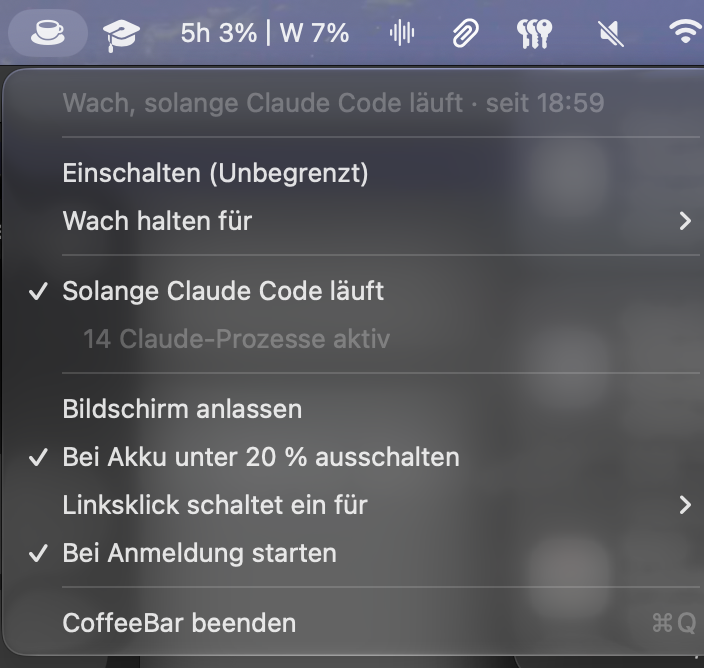

<p align="center"></p>

# CoffeeBar

Eine Kaffeetasse in der Menüleiste, die den Mac wach hält – wie `caffeinate`, nur per Klick.

<p align="center"></p>

- **Linksklick** auf die Tasse: an/aus (gefüllte Tasse = wach)
- **Rechtsklick** (oder ⌥-/⌃-Klick): Menü mit allen Optionen

## Optionen

| | |
|---|---|
| **Wach halten für** | 15 Min, 30 Min, 1, 2, 4, 8 Std oder unbegrenzt. Mit Timer steht die Restzeit neben der Tasse. |
| **Solange Claude Code läuft** | Standardmäßig an. Der Mac bleibt automatisch wach, solange irgendwo ein `claude`-Prozess läuft, und darf wieder schlafen, sobald alle beendet sind. Ersetzt das manuelle `caffeinate`. |
| **Bildschirm anlassen** | Zusätzlich den Bildschirm wach halten (wie `caffeinate -d`). Standard: aus, der Bildschirm darf ausgehen, der Mac arbeitet weiter. |
| **Bei Akku unter 20 % ausschalten** | Standard: an. |
| **Linksklick schaltet ein für** | Standarddauer für den Linksklick. |
| **Bei Anmeldung starten** | Über `SMAppService`. |

Technisch nutzt die App IOKit-Power-Assertions (`PreventUserIdleSystemSleep`, optional `PreventUserIdleDisplaySleep`) – dasselbe wie `caffeinate`, ohne Kindprozess. Prüfen mit `pmset -g assertions | grep CoffeeBar`.

**Hinweis:** Zuklappen des MacBooks schickt es trotzdem schlafen (außer mit externem Bildschirm am Netzteil). Das kann auch `caffeinate` nicht verhindern.

## Installation

```bash
./build.sh
```

Baut mit Swift Package Manager, signiert ad hoc, kopiert nach `~/Applications` und startet. Voraussetzung: macOS 13+, Xcode oder Command Line Tools.

Icon neu erzeugen: `swift tools/make-icon.swift Resources/AppIcon.png`

## Deinstallieren

```bash
pkill -x CoffeeBar; rm -rf ~/Applications/CoffeeBar.app
defaults delete de.maxgerbeth.CoffeeBar
```
